# PhytoDoctor Technical Audit: 08 - Database Schema & Architecture

> **Engine:** SQLite 3 (Async via `aiosqlite`)  
> **ORM:** SQLAlchemy 2.0 (Declarative Mapped Classes)  
> **Target Production Engine:** PostgreSQL (`asyncpg`)  
> **Schema Initialization:** Automated at startup via `Base.metadata.create_all`

---

## 1. Entity-Relationship (ER) Diagram

```mermaid
erDiagram
    users ||--o{ field_visits : "submits"
    users ||--o{ field_visits : "reviews"
    users ||--o{ employee_targets : "assigned"
    users ||--o{ employee_targets : "created_by"
    users ||--o{ customers : "assigned_to"
    users ||--o{ customers : "registered_by"
    users ||--o{ attendances : "clocks"
    users ||--o{ refresh_tokens : "owns"
    users ||--o{ audit_events : "triggers"
    users ||--o{ users : "supervises"
    chat_rooms ||--o{ chat_messages : "contains"
    users ||--o{ chat_messages : "sends"

    users {
        string id PK "UUID"
        string full_name "NOT NULL"
        string email "UNIQUE, INDEX"
        string username "UNIQUE, INDEX"
        string hashed_password "bcrypt"
        string role "INDEX (OWNER/MANAGER/EMPLOYEE)"
        boolean is_active "INDEX"
        string phone "Nullable"
        string designation "Nullable"
        string manager_id FK "users.id (SET NULL)"
        string created_by_id FK "users.id (SET NULL)"
        string assigned_password "Nullable (Plaintext)"
        datetime created_at "UTC"
        datetime updated_at "UTC"
    }

    field_visits {
        string id PK "UUID"
        string employee_id FK "users.id (CASCADE)"
        string client_name "NOT NULL"
        string client_phone "Nullable"
        text notes "Nullable"
        float latitude "NOT NULL"
        float longitude "NOT NULL"
        float gps_accuracy "NOT NULL"
        boolean is_mock_location "DEFAULT FALSE"
        datetime device_capture_time "NOT NULL UTC"
        datetime server_receipt_time "DEFAULT UTC"
        string photo_asset_id "UNIQUE, INDEX"
        string photo_url "Nullable"
        text photo_metadata "JSON Nullable"
        datetime photo_uploaded_at "Nullable"
        boolean is_flagged_for_review "INDEX"
        text review_signals "JSON Array"
        float clock_drift_seconds "Nullable"
        string status "INDEX (PENDING/VERIFIED/REJECTED)"
        text review_reason "Nullable"
        string reviewed_by_id FK "users.id (SET NULL)"
        datetime reviewed_at "Nullable"
        datetime created_at "UTC"
        datetime updated_at "UTC"
    }

    employee_targets {
        string id PK "UUID"
        string employee_id FK "users.id (CASCADE)"
        integer target_count "DEFAULT 6"
        string period_type "DAILY/WEEKLY/MONTHLY"
        date start_date "INDEX"
        date end_date "INDEX"
        string created_by_id FK "users.id (SET NULL)"
        datetime created_at "UTC"
        datetime updated_at "UTC"
    }

    customers {
        string id PK "UUID"
        string name "NOT NULL, INDEX"
        string phone "Nullable"
        string customer_type "FARMER/DEALER/DISTRIBUTOR"
        string territory "NOT NULL, INDEX"
        text address "Nullable"
        string crop_focus "Nullable"
        float latitude "DEFAULT 30.1575"
        float longitude "DEFAULT 71.5249"
        string assigned_employee_id FK "users.id (SET NULL)"
        string created_by_id FK "users.id (CASCADE)"
        datetime created_at "UTC"
        datetime updated_at "UTC"
    }

    attendances {
        string id PK "UUID"
        string user_id FK "users.id (CASCADE)"
        date date "NOT NULL, INDEX"
        datetime clock_in_time "NOT NULL UTC"
        datetime clock_out_time "Nullable UTC"
        boolean is_active "INDEX"
    }

    refresh_tokens {
        string id PK "UUID"
        string user_id FK "users.id (CASCADE)"
        string token_hash "UNIQUE, INDEX (SHA-256)"
        datetime expires_at "NOT NULL UTC"
        boolean is_revoked "INDEX"
        datetime created_at "UTC"
    }

    chat_rooms {
        string id PK "UUID"
        string title "NOT NULL"
        string room_type "INDEX (ANNOUNCEMENT/MANAGEMENT/DIRECT)"
        string created_by_id FK "users.id"
        string participant_1_id FK "users.id"
        string participant_2_id FK "users.id"
        datetime created_at "UTC"
        datetime updated_at "UTC"
    }

    chat_messages {
        string id PK "UUID"
        string room_id FK "chat_rooms.id (CASCADE)"
        string sender_id FK "users.id (SET NULL)"
        string sender_name "NOT NULL"
        string sender_role "NOT NULL"
        text content "NOT NULL"
        boolean is_announcement "DEFAULT FALSE"
        datetime created_at "INDEX UTC"
    }

    audit_events {
        string id PK "UUID"
        string actor_id FK "users.id (SET NULL)"
        string actor_role "Nullable"
        string action "INDEX NOT NULL"
        string affected_record_id "INDEX"
        string affected_record_type "Nullable"
        datetime server_timestamp "INDEX UTC"
        text metadata_json "Nullable"
    }

    app_version_configs {
        integer id PK "DEFAULT 1"
        string latest_version "DEFAULT 1.0.0"
        integer latest_build_number "DEFAULT 1"
        integer min_required_build_number "DEFAULT 1"
        boolean force_update "DEFAULT TRUE"
        string title "NOT NULL"
        text message "NOT NULL"
        text release_notes "NOT NULL"
        string download_url "NOT NULL"
        datetime updated_at "UTC"
    }
```

---

## 2. Table-by-Table Technical Breakdown

### 2.1. `users` Table
- **Model:** `backend/app/models/user.py:User`
- **Purpose:** Central entity for all system users (CEO, Managers, Field Agronomists).
- **Constraints & Indexes:**
  - `email`: UNIQUE constraint, B-tree index.
  - `username`: UNIQUE constraint, B-tree index.
  - `role`: B-tree index (values: `OWNER`, `MANAGER`, `EMPLOYEE`).
  - `is_active`: B-tree index.
  - `manager_id`: Foreign Key referencing `users.id` with `ondelete="SET NULL"`.
- **Identified Defect / Security Finding:**
  - `assigned_password`: Column stores user passwords in **plaintext**. This is used to allow supervisors to view and share passwords via WhatsApp, but violates secure credential storage principles.

### 2.2. `field_visits` Table
- **Model:** `backend/app/models/visit.py:FieldVisit`
- **Purpose:** On-site field inspection records, GPS telemetry, and photo evidence.
- **Constraints & Indexes:**
  - `photo_asset_id`: String(255), UNIQUE constraint, B-tree index. Guarantees evidence immutability.
  - `employee_id`: Foreign Key referencing `users.id` with `ondelete="CASCADE"`.
  - `status`: B-tree index (values: `PENDING`, `VERIFIED`, `REJECTED`).
  - `is_flagged_for_review`: B-tree index.

### 2.3. `employee_targets` Table
- **Model:** `backend/app/models/target.py:EmployeeTarget`
- **Purpose:** Configurable field visit targets.
- **Constraints & Indexes:**
  - `start_date` and `end_date`: B-tree indexes for fast date-range queries.
  - `target_count`: Default `6`.
  - `period_type`: Default `'DAILY'`.

### 2.4. `customers` Table
- **Model:** `backend/app/models/customer.py:Customer`
- **Purpose:** Registry of farms, dealers, and distributors.
- **Coordinates:** Defaults to Multan centroid (`30.1575° N, 71.5249° E`).

### 2.5. `attendances` Table
- **Model:** `backend/app/models/attendance.py:Attendance`
- **Purpose:** Shift tracking and daily active status.
- **Indexes:** `user_id`, `date`, `is_active`.

### 2.6. `refresh_tokens` Table
- **Model:** `backend/app/models/refresh_token.py:RefreshToken`
- **Purpose:** Long-lived JWT session refresh tokens.
- **Constraints:** `token_hash`: UNIQUE, B-tree index. Stores SHA-256 hash (never raw token).

### 2.7. `chat_rooms` & `chat_messages` Tables
- **Model:** `backend/app/models/chat.py`
- **Purpose:** Internal communications. Cascade deletion from room to messages.

### 2.8. `audit_events` Table
- **Model:** `backend/app/models/audit.py:AuditEvent`
- **Purpose:** Immutable append-only record of administrative and sensitive operations.

### 2.9. `app_version_configs` Table
- **Model:** `backend/app/models/app_version.py:AppVersionConfig`
- **Purpose:** Singleton row (`id=1`) controlling client app version gating.

---

## 3. Database Consistency & Architectural Risks

| Risk Area | Finding | Severity | Impact |
|-----------|---------|:--------:|--------|
| **Ephemeral Disk** | Render free tier runs on ephemeral containers. Every deploy or container restart destroys `phyto_doctor.db`. | **CRITICAL** | Total data loss for users, visits, and audit logs. |
| **Foreign Key Enforcement** | SQLite does not enforce foreign keys by default unless `PRAGMA foreign_keys = ON;` is executed on every connection. | **HIGH** | Orphaned visits or target records if a user is deleted. |
| **Plaintext Password Column** | `User.assigned_password` stores plaintext passwords in the database. | **CRITICAL** | Complete credential compromise if database file is accessed. |
| **No Migration Tracking** | App relies on `Base.metadata.create_all`. Alembic is not tracking schema changes. | **HIGH** | Column modifications (renaming, altering types) fail silently or require manual database drops. |
| **Concurrent Write Locks** | SQLite locks the entire database file during write transactions. | **MEDIUM** | Under simultaneous uploads from 20+ field officers, `database is locked` errors can occur. |
