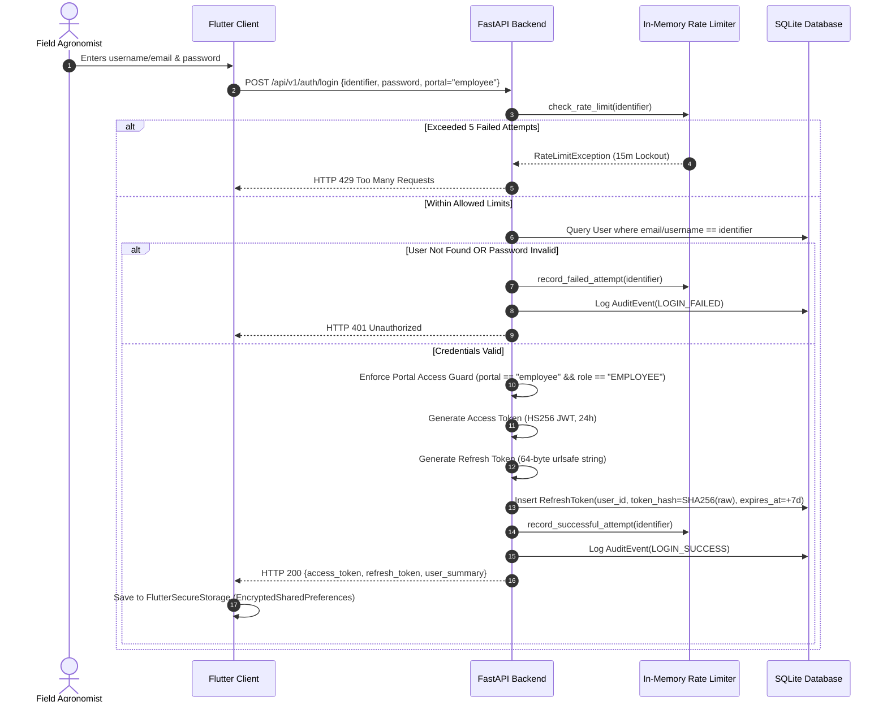

# PhytoDoctor Technical Audit: 09 - Authentication & Security

> **Inspection Scope:** Cryptographic implementations, token lifecycles, session storage, authorization guards, and vulnerability assessment across backend and mobile client.

---

## 1. Authentication Architecture & Token Lifecycle



---

## 2. Cryptographic Implementations

| Component | Standard / Algorithm | Parameters / Configuration | Code Reference |
|-----------|----------------------|----------------------------|----------------|
| **Password Hashing** | bcrypt | `rounds = 12` (Production) / `4` (Test) | `app/core/security.py:get_password_hash` |
| **Password Verification**| `bcrypt.checkpw` | Constant-time string comparison | `app/core/security.py:verify_password` |
| **Access Tokens** | JWT (JSON Web Tokens) | HS256 algorithm; `exp = 1440` minutes (24h) | `app/core/security.py:create_access_token` |
| **Refresh Tokens** | Cryptographic Random | `secrets.token_urlsafe(64)`; high entropy | `app/core/security.py:generate_refresh_token` |
| **Refresh Storage Hash** | SHA-256 | `hashlib.sha256().hexdigest()` | `app/core/security.py:hash_refresh_token` |
| **Client KeyStore** | Android KeyStore | `EncryptedSharedPreferences` via AES-256 | `mobile/core/storage/secure_storage_service.dart` |

---

## 3. JWT Claims & Payload Structure

Access tokens generated by `create_access_token` contain the following payload:

```json
{
  "sub": "c138f6d8-1422-4871-889d-7db1a7199ce5",
  "role": "EMPLOYEE",
  "type": "access",
  "iss": "phyto-doctor-auth",
  "exp": 1794830400
}
```

- **Subject (`sub`):** Unique UUID of the authenticated user.
- **Role (`role`):** User privilege level (`OWNER`, `MANAGER`, `EMPLOYEE`).
- **Token Type (`type`):** Must strictly equal `'access'`. Refresh attempts using access tokens are rejected.
- **Issuer (`iss`):** Hardcoded string `'phyto-doctor-auth'`.

---

## 4. Role-Based Access Control (RBAC) Hierarchy

```
     ┌───────────────────────┐
     │      OWNER (CEO)      │
     │  Full Global Access   │
     └───────────┬───────────┘
                 │ (Inherits & Overrides)
                 ▼
     ┌───────────────────────┐
     │   MANAGER (Admin)     │
     │  Team-Scoped Access   │
     └───────────┬───────────┘
                 │ (Supervises)
                 ▼
     ┌───────────────────────┐
     │  EMPLOYEE (Agronomist)│
     │   Own-Data Only       │
     └───────────────────────┘
```

### Authorization Dependencies in `backend/app/core/deps.py`:
- `require_admin`: Grants access only if `user.role in ['OWNER', 'MANAGER']`.
- `require_owner`: Grants access only if `user.role == 'OWNER'`.
- `require_employee`: Grants access only if `user.role == 'EMPLOYEE'`.

### SQL Query Scoping Rules:
- **Agronomists:** `WHERE employee_id == current_user.id`.
- **Managers:** `WHERE employee_id == current_user.id OR employee_id IN (SELECT id FROM users WHERE manager_id == current_user.id)`.
- **Owners:** No `WHERE` filter applied unless an optional `employee_id` query parameter is provided.

---

## 5. Security Vulnerability Assessment & Risk Register

| Vulnerability ID | Vulnerability Title | Severity | Impact Description | Remediation Path |
|------------------|---------------------|:--------:|--------------------|------------------|
| **SEC-01** | **Plaintext Password Storage** | **CRITICAL** | `User.assigned_password` column stores passwords in cleartext in the database. Anyone with database read access compromises all accounts. | Remove `assigned_password`. Generate one-time temporary activation tokens for new accounts. |
| **SEC-02** | **Default JWT Secret Key Fallback** | **HIGH** | `config.py` contains a hardcoded fallback string `"phyto_doctor_jwt_secret_key_production_override_required_2026"`. If `SECRET_KEY` is not set in Render, anyone can forge admin JWTs. | Raise a startup exception if `ENVIRONMENT == "production"` and `SECRET_KEY` is at its default value. |
| **SEC-03** | **CORS Wildcard Configuration** | **HIGH** | `BACKEND_CORS_ORIGINS: List[str] = ["*"]` with `allow_credentials=True`. Allows any malicious web domain to execute authenticated requests if a user is logged in via browser. | Restrict CORS origins strictly to official domains (`https://admin.phytodoctor.pk`, `https://phytodoctor.pk`). |
| **SEC-04** | **In-Memory Rate Limiting** | **MEDIUM** | Rate limiting is tracked in memory (`rate_limit.py`). If Uvicorn restarts or uses multiple workers, rate limits are bypassed. | Migrate rate limiting to Redis or an external state store. |
| **SEC-05** | **No Device / IP Token Binding** | **MEDIUM** | JWT tokens do not track device hardware IDs or IP addresses. If an access token is intercepted, it can be replayed from any client. | Bind access tokens to device installation UUIDs. |
| **SEC-06** | **Lack of Multi-Factor Authentication** | **MEDIUM** | Executive leadership (CEO/Admins) authenticate with single-factor passwords. | Implement TOTP or SMS OTP verification for administrative accounts. |
