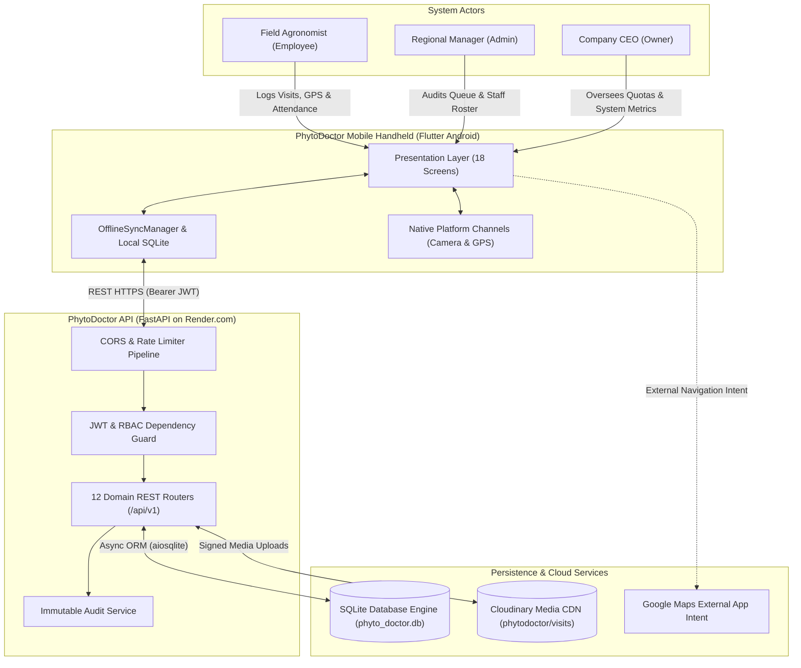
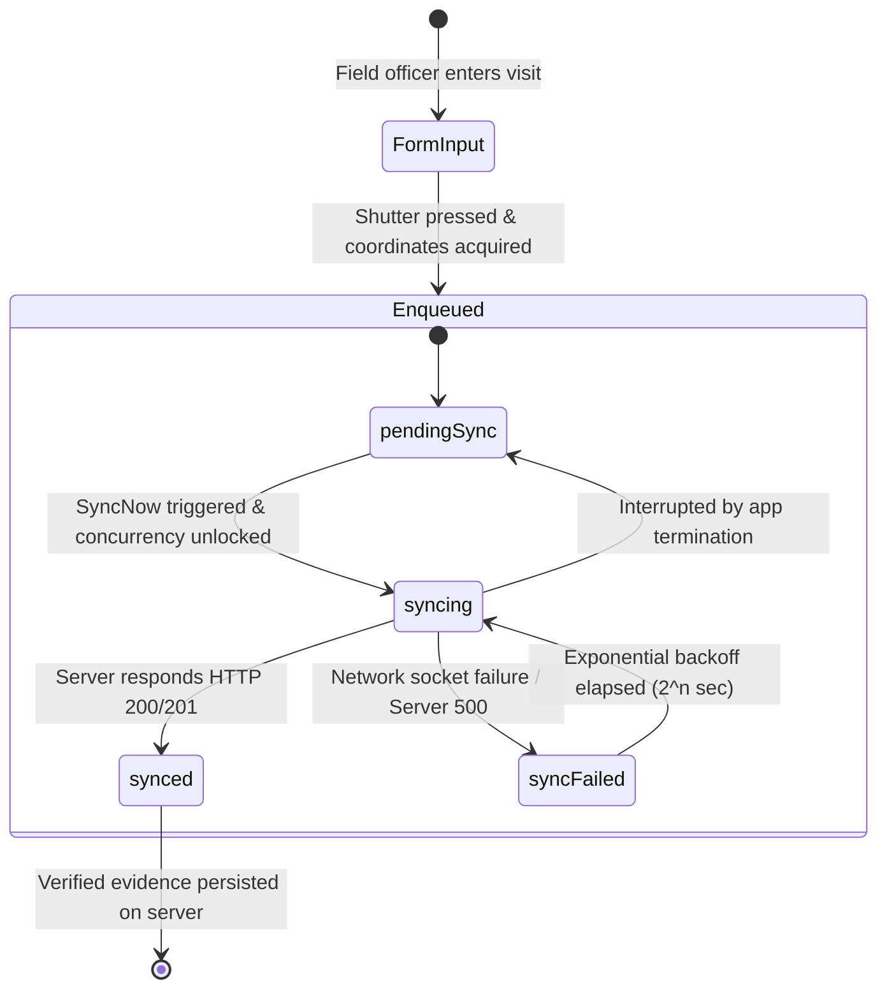
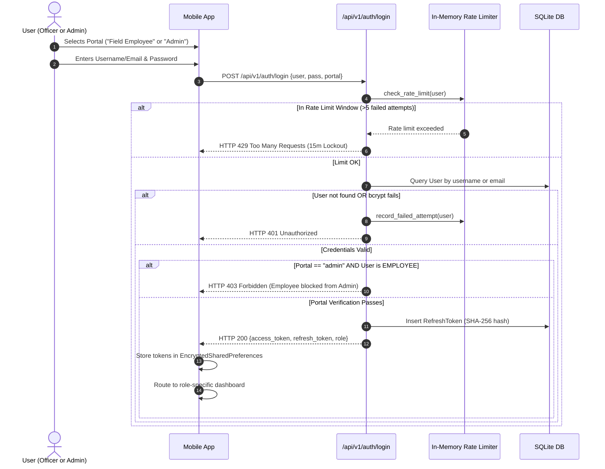
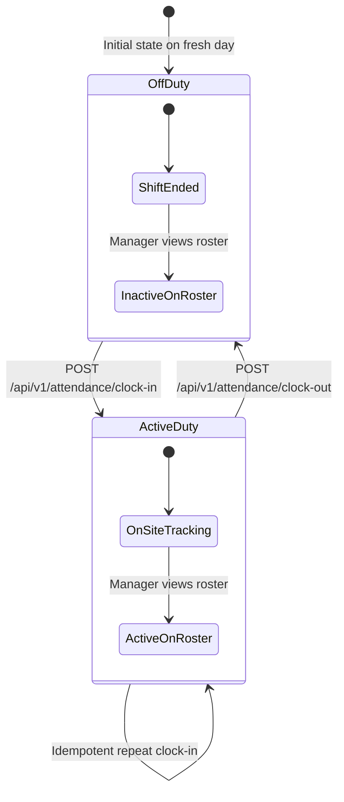
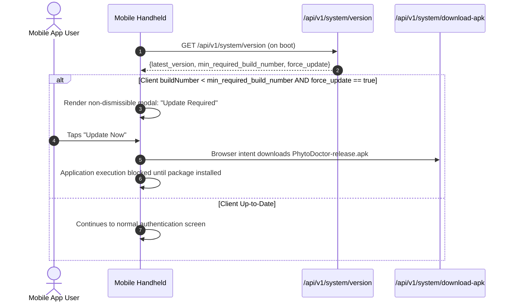

# PhytoDoctor Technical Audit: 15 - Architecture Diagrams

> **Format:** GitHub Flavored Markdown with Native Mermaid Diagrams.

---

## 1. High-Level System Context Diagram



---

## 2. End-to-End Field Visit Submission & Verification Sequence

```mermaid
sequenceDiagram
    autonumber
    actor Agronomist as Field Agronomist
    participant Mobile as Mobile App (Flutter)
    participant LocalDB as Local SQLite
    participant API as FastAPI Backend
    participant Cloudinary as Cloudinary Edge
    participant DB as Backend SQLite
    actor Manager as Regional Manager

    Agronomist->>Mobile: Captures photo & logs farmer visit
    Mobile->>Mobile: Locks GNSS Coordinates (accuracy, mock check)
    Mobile->>LocalDB: Enqueue Visit (status="pendingSync", client UUID)
    
    alt Device is Online
        Mobile->>Cloudinary: Upload Photo Evidence (Multipart/Signed)
        Cloudinary-->>Mobile: Return photo_url & photo_asset_id
        Mobile->>API: POST /api/v1/visits (VisitCreate + UUID)
        API->>DB: Check UUID Idempotency & Photo Asset Uniqueness
        API->>API: Calculate Clock Drift & Accuracy Review Signals
        API->>DB: Insert FieldVisit (status="PENDING")
        API->>DB: Log AuditEvent("VISIT_CREATED")
        API-->>Mobile: HTTP 201 Created (VisitResponse)
        Mobile->>LocalDB: Update status="synced"
    end

    Manager->>Mobile: Opens Verification Queue
    Mobile->>API: GET /api/v1/visits?status=PENDING
    API->>DB: Query pending visits for supervised team
    API-->>Mobile: Return pending visit list
    Manager->>Mobile: Inspects Photo & Reviews GPS accuracy
    Manager->>Mobile: Taps "Approve" (or "Flag/Reject")
    Mobile->>API: POST /api/v1/visits/{id}/verify {status="VERIFIED"}
    API->>DB: Update FieldVisit status to VERIFIED
    API->>DB: Log AuditEvent("VISIT_VERIFIED")
    API-->>Mobile: HTTP 200 OK
    Manager->>Mobile: Visit counter updates; employee quota achieved
```

---

## 3. Offline Synchronization State Machine



---

## 4. User Authentication & Portal Access Control



---

## 5. Shift Attendance State Machine



---

## 6. Mandatory In-App Update Verification Sequence


