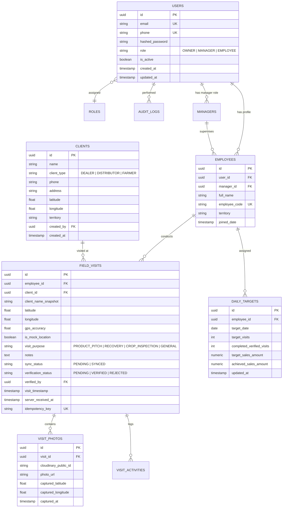
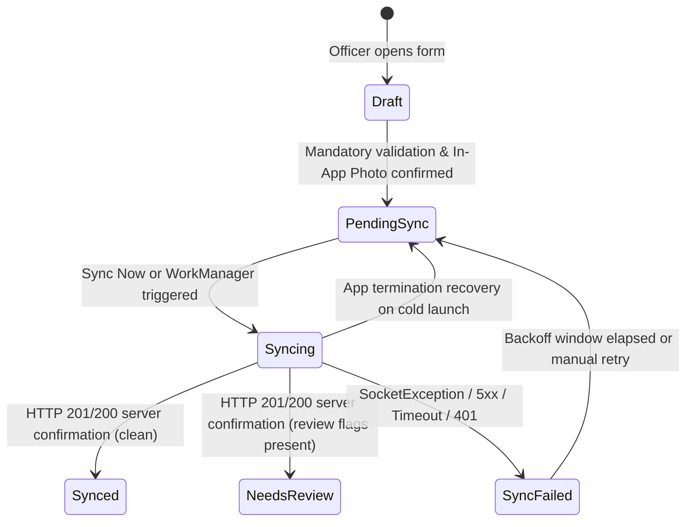

# Phyto Doctor — System Architecture & Technical Specification

## 1. System Overview

**Phyto Doctor** is an enterprise field-tracking and visit verification solution tailored for agricultural inputs, fertilizers, and pesticides distribution. 

The system enables field officers (agronomists, sales reps, technical advisers) to record on-site farmer/dealer visits with verified geotagged photos and client interactions, even when working in rural areas without active cellular connectivity. Managers and Owners can monitor field operations, track sales targets, and review verified visit logs through a centralized web dashboard.

```
                      +---------------------------------------+
                      |       Flutter Android App             |
                      |   (Field Officers / Agronomists)      |
                      |  - Offline SQLite Cache (Drift/Hive)  |
                      |  - In-App Camera Only (No Gallery)   |
                      |  - GPS Coordinate & Geofence Capture  |
                      |  - Background Sync Queue Engine       |
                      +-------------------+-------------------+
                                          |
                                          | HTTPS / REST (JWT)
                                          v
+------------------------+    +-----------+-----------+    +-----------------------+
|  Admin Web Dashboard   |    |    FastAPI Backend    |    |  Cloudinary Storage   |
| (React + Vite + TS)    |--->|  - Auth & RBAC        |<---| - Optimized Leaf/Field|
| - Owner / Manager View |    |  - Visit Verification |    |   Photos              |
| - Targets & Analytics  |    |  - Target Engine      |    | - Secure Delivery     |
| - Team Management      |    |  - Sync Endpoints     |    +-----------------------+
+------------------------+    +-----------+-----------+
                                          |
                                          | SQLAlchemy 2.0 (Async)
                                          v
                              +-----------+-----------+
                              |   PostgreSQL Database |
                              |  - Users & Roles      |
                              |  - Verified Visits    |
                              |  - Targets & Logs     |
                              +-----------------------+
```

---

## 2. Component Responsibilities

### 2.1 Mobile Application (Flutter & Dart)
* **Target OS:** Android (API 24+ / Android 7.0+).
* **Role & Scope:**
  * **Authentication:** Secure credential storage via `flutter_secure_storage`. Zero public signup; accounts provisioned by administration.
  * **In-App Camera Capture:** Enforces live photo capture using device camera sensors via `camera` package. Directly disables photo-picker/gallery access to prevent fabricated visit proof.
  * **Location Intelligence:** High-accuracy GPS capture via `geolocator`. Records latitude, longitude, altitude, accuracy radius, and mock-location detection flags.
  * **Offline Data Storage:** Embedded local database (`drift` / SQLite or `isar`) storing clients, visit drafts, and pending synchronization queues.
  * **Resilient Sync Engine:** Detects network availability (`connectivity_plus`) and synchronizes visits in batches with retry logic, backoff, and idempotency keys.
  * **Target & Visit Dashboard:** Displays assigned daily/monthly farmer visit quotas, completion percentages, and verified visit history.

### 2.2 Backend API (Python FastAPI)
* **Framework:** FastAPI with Python 3.11+.
* **Role & Scope:**
  * **API Gateway & Router:** RESTful endpoints for Auth, Visits, Clients, Targets, and Analytics.
  * **Role-Based Access Control (RBAC):** Strict authorization middleware separating Owner, Manager, and Employee access.
  * **Visit Processing & Verification Engine:**
    * Validates GPS coordinate plausibility and timestamp sequencing.
    * Marks visits as `PENDING_REVIEW`, `VERIFIED`, or `REJECTED`.
    * Performance scoring triggers only on `VERIFIED` visits.
  * **Media Mediation:** Issues direct presigned upload signatures or processes compressed photo streams to Cloudinary, keeping backend RAM and bandwidth minimal.
  * **Audit Logging:** Immutably records user actions, visit approvals, and account modifications.

### 2.3 Relational Database (PostgreSQL)
* **Role & Scope:**
  * Persistent source of truth with foreign key constraints, indexes, and transactional integrity.
  * Supports spatial data coordinates (PostGIS or indexed float pairs for latitude/longitude).
  * Stores user profiles, hierarchy associations (Manager $\rightarrow$ Employees), client directories (Dealers, Distributors, Farmers), daily targets, and verified visit logs.

### 2.4 Admin Web Dashboard (React, TypeScript, Vite)
* **Role & Scope:**
  * **Owner Dashboard:**
    * Company-wide operational overview: daily visits count, team target progress, heatmaps of visited regions.
    * User management: Create, assign, deactivate employees and managers.
    * Target setting: Monthly/daily visit quotas and sales metrics.
  * **Manager Dashboard:**
    * View assigned team members only.
    * Audit and review individual visit details (map pin, client details, captured photo, time on site).
    * Approve or flag questionable visits.
  * **Reporting & Exporting:** Export verified visit reports to Excel/CSV and PDF for business reviews.

### 2.5 Media Storage (Cloudinary)
* **Role & Scope:**
  * Optimized image transformations (automatic WebP conversion, thumbnail generation, resolution scaling).
  * Secure, tamper-proof CDN delivery.
  * Watermarking on upload (timestamp, coordinates, officer ID embedded on the image).

---

## 3. Database Schema Design



---

## 4. API Communication & Synchronization Flow

### 4.1 Authentication & Authorization Flow
1. **Login Request:** Client submits phone/email + password to `/api/v1/auth/login`.
2. **Token Response:** Backend issues:
   * Short-lived `access_token` (JWT, 1 hour).
   * Secure `refresh_token` (Stored in database with expiration and revocation capability).
3. **Role Enforcement:** FastAPI dependencies extract claims (`role`, `user_id`, `manager_id`) and protect administrative endpoints.

### 4.2 Offline Visit Creation & Sync Workflow

```
[Mobile Device (Offline)]
   |
   |-- 1. Officer arrives at farm/shop
   |-- 2. App locks high-accuracy GPS (lat, long, accuracy, isMocked)
   |-- 3. In-App Camera launches -> photo captured -> compressed locally (JPEG/WebP < 400KB)
   |-- 4. Visit Draft saved in local SQLite with unique client UUID + Idempotency Key
   |-- 5. Added to "Pending Sync Queue"
   |
[Network Available (Edge / 4G / Wi-Fi)]
   |
   |-- 6. Background Sync Worker triggers
   |-- 7. Pre-flight check: POST /api/v1/visits/sync-batch
   |       - Sends visit metadata, GPS coordinates, client details, and idempotency key
   |-- 8. Backend acknowledges visit metadata and issues Presigned Upload Signatures
   |-- 9. Mobile uploads compressed photo directly to Cloudinary via CDN
   |-- 10. Mobile informs Backend: PUT /api/v1/visits/{id}/confirm-photo
   |-- 11. Backend marks visit as SYNCED (Status: PENDING_VERIFICATION)
   |-- 12. Mobile marks local visit as SYNCED
```

### 4.3 Verification & Target Recalculation
* **Verification Trigger:** Manager or Owner reviews visit via Web Dashboard.
* **Status Transition:** `PENDING` $\rightarrow$ `VERIFIED` or `REJECTED`.
* **Performance Metric Computation:**
  $$\text{Target Completion \%} = \frac{\sum \text{Verified Visits}}{\text{Target Quota}} \times 100$$
  *Unverified drafts or rejected visits never increment employee performance counters.*

---

## 5. Technology Stack & Dependency Selection

| Component | Framework / Library | Purpose / Rationale |
| :--- | :--- | :--- |
| **Mobile App** | **Flutter 3.x / Dart** | Single codebase compiled to native Android arm64/x86; high performance. |
| Mobile State | **Bloc / Cubit** or **Riverpod** | Deterministic state machine, ideal for offline/online sync queues. |
| Mobile DB | **Drift (SQLite)** | Fast, ACID-compliant offline cache with relational querying & migrations. |
| Mobile Camera | **`camera` package** | Direct camera hardware stream access; completely bypasses gallery picker. |
| Mobile GPS | **`geolocator`** | Fast GPS locking, accuracy filtering, and mock location detection. |
| **Backend** | **Python 3.11+ / FastAPI** | High-performance asynchronous API, auto Swagger docs, Pydantic validation. |
| ORM & Migrations | **SQLAlchemy 2.0 (Async) + Alembic** | Enterprise-grade query engine with typed models and robust migration tooling. |
| Auth & Crypto | **`pwdlib` / `passlib` (Argon2 / BCrypt) + `PyJWT`** | Secure password hashing and stateless token issuance. |
| Cloud Storage SDK | **`cloudinary` Python SDK** | Upload mediation, signed URLs, and auto-transformation tags. |
| **Admin Web** | **React 18 + TypeScript + Vite** | Blazing fast build tooling, typed component trees, zero bloat. |
| Web UI / Styling | **Tailwind CSS + Lucide Icons + Shadcn/Radix** | Sleek, modern, highly responsive dashboard design. |
| Web State & Data | **TanStack Query (React Query) + Axios** | Automatic caching, polling, and background data synchronization. |
| Maps Integration | **Leaflet / OpenStreetMap** (or Google Maps JS) | Zero-cost interactive map rendering for visit tracking. |

---

## 6. Infrastructure & Hosting Cost Analysis (Lean / Low-Cost)

The architecture is deliberately designed to stay within **Free to Minimal Tiers** during development and early operations:

| Resource | Provider | Recommended Plan | Estimated Monthly Cost |
| :--- | :--- | :--- | :--- |
| **Backend Hosting** | Render | Free Tier (Web Service, auto-spins down on idle) $\rightarrow$ Starter ($7/mo when in full daily production) | **$0 – $7 / mo** |
| **PostgreSQL Database** | Render / Neon / Supabase | Free Tier (Up to 500MB – 1GB storage, easily supports 50,000+ visit records) | **$0 / mo** |
| **Photo Storage** | Cloudinary | Free Tier (25 monthly credits = ~25,000 transformations/storage units) | **$0 / mo** |
| **Map Tiles** | OpenStreetMap / CartoDB | Free community tiles / Leaflet integration | **$0 / mo** |
| **Admin Dashboard** | Vercel / Netlify / Render Static | Free Global CDN hosting | **$0 / mo** |
| **Mobile Distribution** | Direct APK / Firebase App Distro | Direct download link for company devices / Internal test track | **$0 / mo** |
| **Total Estimated Operating Cost** | | | **$0 – $7 / month** |

*No Redis, Kubernetes, or microservice overhead.* SQLite handles local queueing, and PostgreSQL native connection pooling handles backend concurrency.

---

## 7. Security, Offline Sync & Photo Storage Risk Matrix

| Risk Category | Potential Threat / Issue | Mitigation Strategy |
| :--- | :--- | :--- |
| **Fake Field Visits (GPS Spoofing)** | Officers use mock location apps (e.g. "Fake GPS") to fake on-site visits. | 1. Enable `isMocked` detection via Android Location API.<br>2. Compare network timestamp with device clock to prevent time manipulation.<br>3. Validate GPS accuracy radius ($\le 50\text{m}$). |
| **Gallery / Old Photo Upload** | Officers upload existing photos from phone gallery instead of being on-site. | 1. Strictly use Flutter `camera` controller; do not include `image_picker` gallery permissions.<br>2. Restrict UI to direct shutter tap.<br>3. Burn GPS coordinates, officer ID, and timestamp into photo EXIF and visual watermark. |
| **Offline Sync Data Loss** | App crashes or phone restarts before synced data reaches server. | 1. All records saved to SQLite transactionally before queue entry.<br>2. Idempotency keys (`UUIDv4`) prevent duplicate records on intermittent network retries.<br>3. Local data purged only after HTTP 200/201 response confirmation from backend. |
| **Bandwidth Overuse in Rural 2G/3G** | High-res 12MP photos stall sync queue or fail on poor signal. | 1. In-app compression downscales photos to 1280x720, WebP/JPEG 75% quality (~250–350 KB).<br>2. Upload queue operates sequentially in background.<br>3. Resumable / signed direct upload prevents backend bottleneck. |
| **Unauthorized Account Access** | Disgruntled or terminated employees accessing client data. | 1. No self-service registration.<br>2. Owner/Manager instant deactivation flag (`is_active = false`).<br>3. Token invalidation on user status update. |

---

## 8. Field Visit Evidence, Accuracy & Fraud-Aware Review Policy

### 8.1 Evidence Capture Model
* **Mandatory In-App Camera Only:** Photos must be taken live using the in-app hardware camera shutter. Gallery image selection is permanently disabled in the application manifest and UI to avoid pre-existing photo submissions.
* **Separation of Timestamps:** 
  * `device_capture_time`: Precise UTC timestamp recorded on the physical mobile device at the moment of camera shutter release.
  * `server_receipt_time`: High-precision UTC timestamp recorded by the FastAPI backend upon receipt of the payload.
* **Immutability Guarantee:** Each visit is associated with a unique `photo_asset_id`. Overwriting or resubmitting an existing `photo_asset_id` is strictly rejected with `HTTP 409 Conflict`, guaranteeing that submitted evidence cannot be silently modified.
* **Offline-First Persistence:** Visits are saved locally to `LocalVisitQueue` immediately upon user confirmation, allowing field officers to capture visits in dead zones with zero risk of evidence loss.

### 8.2 Configurable GPS Threshold & Diagnostics
* **50-Meter Accuracy Threshold:** Hardware GNSS reported accuracy must be $\le 50.0\text{ meters}$.
* **Actionable Retry Prompt:** When satellite fix accuracy exceeds 50 meters, the application explains the obstruction (e.g. tin roofs, tall tree canopies, deep indoors) and prompts the user to step into open air and tap **Retry GPS**.
* **Zero Background Tracking:** In strict compliance with privacy standards, location coordinates are acquired exclusively on-demand when tapping submit or calibrate. No background location daemons exist.

### 8.3 Fraud-Aware Review Signals (Not Definitive Proof)
* **Supervisor Review Signals:**
  * `LOW_GPS_ACCURACY`: Reported accuracy exceeded 50m.
  * `REPORTED_MOCK_LOCATION`: Android OS reported simulated location provider.
  * `IMPLAUSIBLE_DEVICE_CLOCK`: Device timestamp significantly deviates from server UTC (>5 minutes future drift).
  * `SUSPICIOUS_UPLOAD_DELAY`: Time delta between capture and upload exceeds 24 hours.
* **Ethical Guidance:**
  * GPS coordinates and device timestamps alone do **not** prove physical presence.
  * System flags are treated as **review indicators** for managers to audit during team discussions, not automated proof of employee misconduct.

---

## 9. Target Management, Historical Preservation & Performance Analytics Engine

### 9.1 Target Architecture & Historical Preservation
* **Effective Date Range Model:** Targets define daily visit expectations with explicit `start_date` and optional `end_date`.
* **Atomic Batch Assignment:** Owners and Managers can assign or update targets across multiple team members simultaneously via `POST /api/v1/targets/batch`.
* **Historical Immutability Guarantee:** When a target is updated or a new target is set, existing historical records are preserved. Historical performance queries use `as_of_date` or slice through the target active on that specific historical date. Past reports never change retroactively when targets are modified for future dates.

### 9.2 Role-Based Access Control (RBAC) Scoping
* **Owner / Admin:** Global authority. Can create, update, and inspect targets and performance analytics across all employees, teams, and arbitrary date ranges.
* **Manager:** Team-scoped authority. Restricted strictly to subordinates where `employee.manager_id == current_user.id`. Setting targets or querying metrics for unassigned staff is rejected with `HTTP 403 Forbidden`.
* **Employee:** Self-scoped authority. Restricted strictly to personal metrics (`employee_id == current_user.id`).

### 9.3 Strict Performance Accounting & Anti-Inflation Rules
* **Verified-Only Rule:** Only visits with `status == VisitStatus.VERIFIED` (`'VERIFIED'`) count toward verified performance and completion percentage.
* **Non-Inflation Principle:** Drafts, pending sync (`PENDING_SYNC`), failed uploads (`SYNC_FAILED`), pending review (`PENDING_REVIEW`), and rejected (`REJECTED`) visits are segregated into distinct metrics and never inflate verified totals.
* **De-duplication:** Aggregations calculate `func.count(distinct(FieldVisit.id))` to guarantee duplicate or multi-synced visits do not inflate totals.
* **Zero Fabrication:** If no targets or visits exist for a period, metrics return zero (`0`); statistics are never guessed or fabricated.

### 9.4 Analytics Breakdown & Team Comparisons
* **Multi-Period Aggregation:** Computes daily, weekly (7-day rolling), and monthly (calendar month) performance windows.
* **Day-by-Day Trend Points:** Generates time-series trend breakdowns mapping target vs verified and submitted visits per day.
* **Review Reason Audit:** Surfaces flagged/rejected visit logs with review reasons to field employees and supervisors for transparent feedback.
* **Team Comparison Leaderboards:** Allows authorized Managers and Owners to view ranked team performance with target, verified visits, remaining visits, and completion percentages.

---

## 10. Cloudinary Media Architecture, Daily Folder Organization & Cost Modeling

### 10.1 Daily-Partitioned Asset Organization
To eliminate randomly scattered assets and ensure clean, auditable media lifecycle management, all field visit photos are strictly organized into **daily chronological folders**:
```
phytodoctor/
└── visits/
    └── {YYYY-MM-DD}/                     # Calendar capture day (e.g., 2026-10-21)
        └── {employee_id_prefix}/          # Field officer identifier
            └── visit_{visit_id}_{entropy} # Unique, collision-free asset ID
```
* **Daily Partitioning:** Every photo's path is anchored to `device_capture_time` or the UTC upload date.
* **Supervisor Navigability:** Cloudinary Media Library displays neatly grouped daily batches, making date-based audits and pruning effortless.
* **Deterministic Path Isolation:** Prevents collision between different officers' visits or repeated uploads.

### 10.2 Security & Credential Protection Model
* **API Secret Isolation:** The Cloudinary API secret is **strictly confined to the FastAPI server environment**. It is never baked into Android APK binaries, Dart source code, or React dashboard assets.
* **Signed Upload Authorization:** The mobile app calls `POST /api/v1/media/visits/{visit_id}/photo-upload-authorization` to acquire a short-lived SHA-1 cryptographic signature restricting `folder`, `public_id`, and `timestamp`.
* **MIME & Magic Header Validation:** Server validates binary magic bytes (`\xff\xd8\xff` for JPEG, `\x89PNG` for PNG, `RIFF...WEBP` for WebP) before accepting any photo evidence. Executables, scripts, and corrupted files are rejected with `HTTP 400 Bad Request`.
* **Payload Size Limits:** Max file size enforced at **10 MB** (typical compressed WebP/JPEG field photos are ~250–350 KB). Exceeding uploads are rejected with `HTTP 413 Content Too Large`.
* **Restricted Evidence Access:** Private visit photos are accessible only via authenticated endpoints (`GET /api/v1/media/visits/{visit_id}/photo-access`). Employees can only view their own photos, managers can only inspect their assigned subordinates' evidence, and unauthenticated requests are blocked with `HTTP 401/403`.

### 10.3 Synchronous 7-Step Offline-to-Cloud Workflow
1. **Capture:** Photo taken live through Flutter in-app camera (gallery disabled).
2. **Local Sandbox:** Saved immediately to app-private storage with SHA verification.
3. **Authorization:** When online, app requests upload authorization from FastAPI.
4. **Secure Upload:** Photo transferred over HTTPS using signed parameters or direct server endpoint.
5. **Association:** Asset ID, delivery URL, dimensions, and metadata associated with `FieldVisit` in PostgreSQL.
6. **Confirmation:** Server verifies association integrity (`POST /api/v1/media/visits/{visit_id}/confirm-photo`).
7. **State Transition:** Local SQLite record marks visit `Synced` only after server confirmation.

### 10.4 Cloudinary Free Tier & Cost Scaling Analysis
* **Programmable Media Free Plan:**
  * **25 Monthly Credits** (1 Credit = 1 GB storage OR 1 GB net bandwidth OR 1,000 transformations).
* **Phyto Doctor Realistic Production Usage (20 Field Agronomists):**
  * 20 employees $\times$ 10 visits/day $\times$ 26 working days = **5,200 visits/month**.
  * Compressed photo average size: 250 KB (WebP/JPEG 75%).
  * Monthly Storage: $5,200 \times 250\text{ KB} \approx \mathbf{1.3\text{ GB/month}}$ (1.3 credits).
  * Monthly Eager Transformations: 5,200 thumbnail conversions $\approx \mathbf{5.2\text{ credits}}$.
  * Monthly Viewing Bandwidth (Supervisors & Agronomists): $\approx \mathbf{0.3\text{ GB/month}}$ (0.3 credits).
  * **Total Estimated Usage:** $\approx \mathbf{6.8\text{ Credits/month}}$ ($\mathbf{27.2\%}$ of the Free Tier).
* **Upgrade Policy & Threshold:**
  * Phyto Doctor operates entirely at **$0 / month** on the Free Tier for early-stage and medium-scale operations.
  * Paid upgrade to **Plus Plan ($89/mo, 225 credits)** is only required when active field workforce exceeds ~75 officers (>18,000 visits/month) and requires explicit Owner approval before provisioning.

---

## 11. Administration Dashboard Architecture (React + TypeScript + Vite)

### 11.1 Technology Stack & Design System
* **Core Framework:** React 19 with TypeScript and Vite.
* **Styling:** Custom Vanilla CSS design system (`admin/src/index.css`) built upon the approved Phyto Doctor visual brand identity:
  * Primary Green: `#1B3B1D` (Canopy Deep Green) and `#28542A` (Field Green).
  * Light Backgrounds: `#F9F8F5` (Warm Off-White) and `#EFF5ED` (Botanical Sage).
  * Status Tokens: `#2E7D32` (Verified), `#E65100` (Pending/Flagged), `#C62828` (Rejected), `#1565C0` (Info).
  * Typography: Google Fonts Inter (`300`, `400`, `500`, `600`, `700`) with high-contrast accessibility on outdoor tablet and desktop screens.
  * Zero generic CSS frameworks (TailwindCSS omitted per architectural guidelines).

### 11.2 Role-Based Access Control & Security Boundaries
* **Strict Admin Authentication (`/login`):** Only authenticated users with `OWNER` or `MANAGER` roles can log into the administration portal. Field `EMPLOYEE` users attempting admin login are rejected with `HTTP 403 Forbidden: Field employees must use the mobile application`.
* **Token Storage:** Short-lived access tokens and refresh tokens stored safely in browser `localStorage`.
* **Session Expiry & Interception:** `admin/src/services/api.ts` automatically attaches `Authorization: Bearer <token>` to all HTTP requests and intercepts `401 Unauthorized` responses to clear sessions and redirect to login.
* **Manager Scoping:** Managers are strictly confined to their assigned team members across visits, targets, and performance views. Only `OWNER` users can manage company-wide configurations and access audit logs.

### 11.3 Comprehensive Screen Specifications
1. **Secure Admin Login (`AdminLogin.tsx`):** Official Phyto Doctor brand identity, username/password form, client-side validation, error handling, and redirection.
2. **Overview Dashboard (`OverviewDashboard.tsx`):** High-level operational KPIs (Today's Total Target, Verified Visits, Completion Rate, Pending Review Queue, Flagged Visits), quick-action links, and recent visit activity table.
3. **Employee Management (`EmployeeManagement.tsx`):** Paginated employee roster, role badges, active/inactive status toggle with instant backend synchronization, and credential reset trigger.
4. **Create Accounts & Reset Credentials (`CreateEmployeeModal.tsx`, `ResetPasswordModal.tsx`):** Modal dialogs for provisioning new employees (full name, username, email, role, supervisor assignment, password) and resetting credentials securely without exposing passwords.
5. **Assign Employee Targets (`TargetManagement.tsx`, `BatchTargetModal.tsx`):** Setting daily, weekly, and monthly visit quotas with start and end dates. Supports individual allocations and atomic batch assignment for entire teams.
6. **Field Visit List (`VisitList.tsx`):** Comprehensive visit log with live search, date filters, employee filter, status filter, and flagged-only filter.
7. **Field Visit Details Modal (`VisitDetailModal.tsx`):** Deep inspection modal displaying client name, phone, notes, photo evidence preview, GPS coordinates, reported accuracy badge, device capture time, server receipt time, clock drift analysis, and review flags.
8. **Visit Verification & Rejection:** Authorized supervisors can verify or reject field visits with a mandatory review reason. Enforces anti-self-verification rule (agronomists cannot verify their own visits) and logs all decisions in PostgreSQL audit events.
9. **Employee Performance (`EmployeePerformance.tsx`):** Detailed drilldown into individual agronomist metrics across daily, weekly, and monthly periods with target vs. verified counts and supervisor review reasons.
10. **Team Performance (`TeamPerformance.tsx`):** Performance leaderboard ranking agronomists by quota attainment percentage, showing team-wide aggregate completion metrics.
11. **Date-Filtered Reports & CSV Export (`ReportsExport.tsx`):** Custom reporting engine with verified vs. unverified visit breakdowns, summary statistics, and RFC 4180-compliant CSV export. **Security Guarantee:** Passwords, password hashes, and auth tokens are strictly scrubbed from exported data.
12. **Audit History (`AuditHistory.tsx`):** Complete immutable system audit trail querying `GET /api/v1/admin/audit-logs` showing actor, action (`CREATE_USER`, `UPDATE_USER`, `RESET_PASSWORD`, `VERIFY_VISIT`, `REJECT_VISIT`), timestamp, and structured metadata.
13. **Application Settings (`SettingsPage.tsx`):** Overview of system security thresholds (GPS 50m tolerance, clock drift 300s limit, token lifetimes) and real-time Cloudinary Free Tier credit consumption monitoring.

### 11.4 Backend Verification & Integration Testing
* **Test Suite:** `backend/tests/test_admin_dashboard_api.py` includes 5 targeted tests covering admin login, company KPI calculation, employee CRUD and password reset, visit audit/verification workflow, and audit log endpoint role isolation.
* **Total Passing Tests:** 43/43 tests passing across the Phyto Doctor backend test suite (100% pass rate).

---

## 12. Controlled Production Rollout, Cost Control & Disaster Recovery

### 12.1 Production Infrastructure Architecture
The Phyto Doctor platform is architected for containerized deployment across Render cloud infrastructure and Cloudinary programmable media storage:

```
                                  +---------------------------------------+
                                  |         DNS / Custom Domain          |
                                  |    api.phytodoctor.pk / dashboard     |
                                  +-------------------+-------------------+
                                                      |
                          +---------------------------+---------------------------+
                          |                                                       |
                          v                                                       v
         +--------------------------------+                     +----------------------------------+
         |     Render Web Service         |                     |       Render Static Site         |
         |    `phytodoctor-api`           |                     |     `phytodoctor-admin`          |
         |  - Python 3.12 / FastAPI       |                     |  - React 19 / TypeScript / Vite  |
         |  - Starter Tier ($7/mo)        |                     |  - Free Tier ($0/mo)             |
         |  - Always-On (No cold starts)  |                     |  - Global Anycast CDN            |
         |  - Workers: 2 Uvicorn async    |                     |  - Managed TLS / Auto Deploy     |
         +---------------+----------------+                     +----------------------------------+
                         |
       +-----------------+-----------------+
       |                                   |
       v                                   v
+-----------------------------+   +------------------------------------+
|      Render PostgreSQL      |   |       Cloudinary CDN & Media       |
|      `phytodoctor-db`       |   |       `phytodoctor/visits/`        |
|  - Basic-256mb ($6-7/mo)    |   |  - Free Plan (25 Credits/mo)       |
|  - Persistent NVMe SSD      |   |  - Ephemeral signed parameters     |
|  - Auto daily backups       |   |  - Zero secrets in client binaries |
|  - Point-in-time recovery   |   +------------------------------------+
+-----------------------------+
```

### 12.2 Exhaustive Cost Control & Budget Analysis
Every tier was evaluated against current 2026 pricing. **No paid services should be activated without prior Owner approval.**

| Component | Provider / Tier | Current Price (USD) | Cold Starts / Inactivity Catch | Production Viability & Recommendation |
| :--- | :--- | :--- | :--- | :--- |
| **Backend Web Service** | Render Free Tier | $0.00 / month | **Sleeps after 15m inactivity**; ~60s cold start delay | ❌ **Unacceptable:** Field officers will experience sync timeouts outdoors. |
| **Backend Web Service** | Render Starter Tier | **$7.00 / month** | **None.** Always-on 512 MB RAM, 0.5 CPU. | ✅ **Recommended:** Guarantees zero latency spikes during field sync. |
| **PostgreSQL Database** | Render Free Tier | $0.00 / month | **Strictly deleted after 30 days!** | ❌ **Prohibited:** Cannot be used in production under any circumstance. |
| **PostgreSQL Database** | Render Basic-256mb | **$6.00 – $7.00 / mo** | Persistent storage; automated daily backups. | ✅ **Recommended:** Reliable, continuous retention with automated backups. |
| **Admin Dashboard** | Render Static Site | **$0.00 / month** | Global CDN; instant cache invalidation. | ✅ **Recommended:** Free tier static site is fully production-grade. |
| **Render Workspace** | Render Hobby Plan | **$0.00 / month** | 1 seat, 25 services, 5 GB egress bandwidth. | ✅ **Recommended:** Sufficient for initial company rollout. |
| **Photo Media Storage** | Cloudinary Free Tier | **$0.00 / month** | 25 Monthly Credits (~6.8 credits consumed by 20 officers). | ✅ **Recommended:** Operates at $0/mo; upgrade to Plus ($89/mo) only when >75 staff. |
| **Custom Domain** | PKNIC (`.pk`) / Registrar | **~$1.00 – $1.25 / mo** | ~$24 billed biannually for `.pk` domain. | ✅ **Recommended:** Required for official brand identity and TLS. |
| **Total Baseline Cost** | **Production Stack** | **~$14.00 – $15.25 / mo** | *(~3,900 – 4,250 PKR/month)* | 🎯 **Maximum efficiency, zero wasted spend.** |

### 12.3 Hardened Security & Anti-Fraud Posture
1. **Login Rate Limiting:** [`LoginRateLimiter`](file:///c:/Users/munee/Downloads/PhytoDoctor/backend/app/core/rate_limit.py) enforces sliding-window threshold (max 5 failed attempts per 15 minutes per user/IP). The 6th attempt is blocked with `HTTP 429 Too Many Requests` and a dynamic `Retry-After` header.
2. **Short-Lived Access & Revocable Refresh Tokens:** 15-minute JWT access tokens coupled with high-entropy cryptographically hashed (SHA-256) refresh tokens stored in PostgreSQL.
3. **Strict RBAC:** Role isolation enforced at the FastAPI dependency layer (`require_owner`, `require_admin`). Mobile employees cannot authenticate to the admin portal (`HTTP 403`).
4. **Zero-Secret Client Exposure:** Cloudinary API secret is confined to FastAPI server environment variables; client Flutter and React code never receive or store it.
5. **Git Secret Exclusion:** [`.gitignore`](file:///c:/Users/munee/Downloads/PhytoDoctor/.gitignore) strictly ignores `.env`, `*.env`, `.jks`, `*.keystore`, `*.dump`, `*.sqlite`, and `backups/`.
6. **Immutable Audit Trails:** Every user creation, status toggle, password reset, visit verification, and rejection generates a permanent audit event in `audit_events`.

### 12.4 Backup & Disaster Recovery Runbook
* **Automated Daily Backups:** Handled natively by Render PostgreSQL with redundant off-site snapshotting.
* **On-Demand Disaster Recovery Utility:** [`backend/scripts/backup_restore.py`](file:///c:/Users/munee/Downloads/PhytoDoctor/backend/scripts/backup_restore.py) provides deterministic backup and recovery:
  * **Backup Command:** `python scripts/backup_restore.py --backup` (triggers `pg_dump --format=custom --blobs`).
  * **Restore Command:** `python scripts/backup_restore.py --restore --file <path_to_dump> --target-url <target_url>`.
  * **Integrity Drill Command:** `python scripts/backup_restore.py --drill` (validates end-to-end backup generation and sandbox restoration with byte parity check).
* **Recovery Objectives:**
  * **RPO (Recovery Point Objective):** $\le 24\text{ hours}$ (Render daily snapshot) or $\le 1\text{ hour}$ with manual script invocation before major administrative migrations.
  * **RTO (Recovery Time Objective):** $\le 15\text{ minutes}$ to provision a restored PostgreSQL instance and point `DATABASE_URL`.

### 12.5 Production Rollout Checklist & Unresolved Risks

#### Automated Verification Status
- [x] Database initial schema migration updated with all models (`001_initial_schema.py`).
- [x] Login rate limiting implemented and verified with automated test (`HTTP 429` lockout).
- [x] `render.yaml` Infrastructure-as-Code Blueprint created and validated.
- [x] React/TypeScript/Vite administration dashboard production bundle compiled (0 errors, 371ms).
- [x] Database disaster recovery drill verified successfully (`backup_restore.py --drill`).
- [x] Full backend test suite passing with 100% success rate (**43/43 tests passing**).
- [x] GitHub Actions CI/CD pipeline configured (`.github/workflows/production-release.yml`).

#### Unresolved Risks & Manual Configuration Requirements (Pre-Launch)
1. **Render Cloud Service Provisioning:**
   * An authorized administrator must connect the private GitHub repository to Render and deploy via `render.yaml` or Render dashboard.
   * **Action Required:** Approval to incur Render's ~$13–14/month compute and database fee (Hobby workspace + Starter Web Service + Basic-256mb PostgreSQL).
2. **Cloudinary Production Credentials:**
   * Production environment variables (`CLOUDINARY_CLOUD_NAME`, `CLOUDINARY_API_KEY`, `CLOUDINARY_API_SECRET`) must be populated in the Render Web Service environment settings.
3. **Android Release Keystore Generation:**
   * Before deploying to Google Play Store, an official release keystore must be generated using Java `keytool` and stored securely offline.
   * Base64 keystore and passwords must be added to GitHub Repository Secrets (`ANDROID_KEYSTORE_BASE64`, `ANDROID_KEY_PROPERTIES`) for the release pipeline.
4. **Physical Outdoor Device Testing in Pakistan:**
   * Test the signed release APK on physical Android test devices outdoors in direct sunlight across major telecom networks (Jazz, Telenor, Zong) to evaluate GNSS accuracy settling times, camera shutter responsiveness, and low-bandwidth sync performance.

---

## 13. Offline-First Synchronization, Idempotency & Conflict Resolution

### 13.1 Local SQLite Storage Architecture
Field officers often operate in remote agricultural belts with intermittent or absent cellular data (e.g. 2G Edge or dead zones). The mobile architecture guarantees **zero data loss** through local transactional persistence:

* **Structured Visit Data:** Managed by [`SqliteVisitDatabase`](file:///c:/Users/munee/Downloads/PhytoDoctor/mobile/lib/core/storage/sqlite_visit_database.dart). Every visit is saved to SQLite before any network request is attempted.
* **App-Private Photo Sandbox:** Managed by [`PhotoStorageService`](file:///c:/Users/munee/Downloads/PhytoDoctor/mobile/lib/core/storage/photo_storage_service.dart). Photos are stored exclusively in the app's sandboxed private internal storage (`/data/user/0/com.phytodoctor/app_flutter/private_evidence/`). This prevents other installed apps or gallery cleaners from tampering with or deleting evidence.
* **Storage Pruning Guard:** Local photos are retained for a minimum of 30 days after server confirmation. **Unsynced photos are strictly protected from deletion under all circumstances.**

### 13.2 Field Visit State Machine
Every visit progresses through deterministic states managed by [`VisitSyncState`](file:///c:/Users/munee/Downloads/PhytoDoctor/mobile/lib/core/models/visit_state.dart):



| State | Meaning | Actions Allowed |
| :--- | :--- | :--- |
| **`Draft`** | In-progress form; uncommitted. | Edit client name, capture photo, acquire GPS. |
| **`Pending Sync`** | Saved in SQLite; awaiting upload window. | View details; trigger manual "Sync Now". |
| **`Syncing`** | In-flight HTTP / Cloudinary transmission. | Concurrency lock active; debounces new taps. |
| **`Synced`** | Backend confirmed visit and photo association. | Read-only; eligible for performance counting. |
| **`Needs Review`** | Confirmed on server, but flagged for review. | Visible in visit history with supervisor flag tags. |
| **`Sync Failed`** | Network or temporary server failure. | Automatically queued for backoff retry; manual retry. |

### 13.3 Synchronization Strategy & Conflict Handling

1. **UUID Idempotency Key:**
   * The mobile client generates a cryptographically unique UUID (`VISIT_{timestamp}_{employee_hash}`) before queue entry.
   * The backend (`POST /api/v1/visits/`) checks whether this UUID already exists for the authenticated employee. If found, it returns the existing record idempotently (`HTTP 200/201`) without duplicating rows or incrementing targets.

2. **Orphaned State Recovery on App Cold Launch:**
   * If the Android OS kills the app or the device reboots while a sync is in-flight, records would remain stuck in `syncing`.
   * During [`SqliteVisitDatabase.initDatabase()`](file:///c:/Users/munee/Downloads/PhytoDoctor/mobile/lib/core/storage/sqlite_visit_database.dart), the system executes `resetStaleSyncingStates()`, which atomically transitions any orphaned `syncing` records back to `pendingSync` with the diagnostic note: *"Upload interrupted by app termination. Recovered from SQLite."*

3. **Exponential Backoff Formula:**
   * Failed attempts trigger progressive backoff to prevent battery drain and cellular radio thrashing:
     $$\text{Backoff Duration} = 2^{\min(\text{attempts}, 5)} \text{ seconds} \quad (1\text{s}, 2\text{s}, 4\text{s}, 8\text{s}, 16\text{s}, 32\text{s}, \max 60\text{s})$$
   * Manual "Sync Now" taps bypass the backoff window to allow immediate user override.

4. **Interrupted Photo Upload Recovery:**
   * If photo upload succeeds to Cloudinary but the subsequent PostgreSQL visit registration drops due to network loss, the generated `photo_upload_url` is cached in SQLite.
   * On the subsequent retry, the sync manager detects the existing valid URL and directly submits the visit payload, preventing duplicate Cloudinary uploads and saving cellular bandwidth.

5. **Expired Authentication Handling (HTTP 401):**
   * If the JWT token expires while offline records are queued, the sync engine immediately pauses the queue and marks visits as `syncFailed` with: *"Session expired (HTTP 401). Local records safely preserved in SQLite. Please log in again."*
   * **Zero Data Loss Guarantee:** Unsynced visits are never deleted on auth failure. Upon re-logging in, the fresh access token is passed to `OfflineSyncManager.syncNow()`, which drains the preserved queue.

6. **Low Device Storage Warning:**
   * The device storage health check scans free internal flash memory.
   * If free space drops below 100 MB, a warning banner is displayed alerting the officer to free device space while safely preserving pending visit evidence.

7. **Never False Success:**
   * A visit is strictly marked `synced` only after receiving a confirmed HTTP response payload containing the verified server ID and timestamp.


